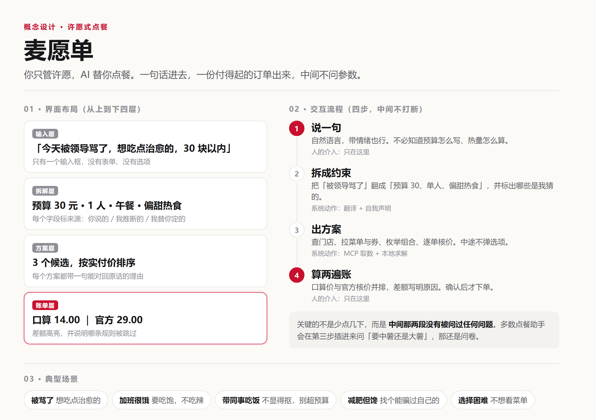

<p align="center">
  
</p>

# 许愿式点餐 · mcd-wish-order

**你许愿，AI 来实现。**

> 你说一句「今天被领导骂了，想吃点治愈的，别超过 30 块」，
> 它自己拆需求、拉菜单、比券、核价，交一份付得起的订单。中间不问你参数。

实现到哪一步、钱是怎么算的，都摊开在明面上：每一单的账算两遍，一遍是模型式的口算，一遍是官方核价，差额直接摆出来。

| | |
|---|---|
| 输入 | 一句话，不填预算表、不选套餐、不做券的算术 |
| 中间 | 不追问。缺的参数按常识补，补了什么明确告诉你 |
| 输出 | 一份可下单的方案 + 两张账单 |
| 差异化 | **每一单的账算两遍，差额公开** |

演示页（本地双击打开，零依赖、不联网）：`docs/index.html`

---

## 一个具体的例子

用户说：

> 今天被领导骂了一顿，想吃点能治愈的，别超过 30 块

它拆出来的是：

```
总预算  30 元    你说的
人数    1 人     我替你定的
餐段    午餐     我推断的
情绪    治愈 → sweet / warm / comfort
```

给出的方案里，第一名是「麦香鸡 + 派」，实付 29.00 元。

同一单的账算两遍：

```
商品原价合计        29.00 元
AI 式口算           14.00 元   扣 15.00
官方口径            29.00 元   扣  0.00

口算这一步：选了面额最大的「满 70 减 15」，但这单只有 29.00 元，差 41.00 元没到门槛
官方真正生效的券：无

差 +15.00 元。口算低估了实付金额。
```

这不是为了做效果而编的错。券的面额越大越诱人，「满 70 减 15」在 29 元的单子上最容易被顺手减掉，而券面上写着门槛。人这样算，模型也这样算。**错的时候，账单看起来完全正常。**

> 上面这组数字来自麦当劳 MCP 的真实菜单返回（2026-10-21 抓取，到店自取场景）。券为示例数据：测试账号券包为空，`query-store-coupons` 返回 `[]`，`available-coupons` 返回 `null`。

---

## 为什么不是又一个省钱助手

对活动仓库全部 938 条报名申请做过统计，其中 **65% 集中在省钱 / 优惠券方向**，且绝大多数要求用户先填好预算、热量上限、想吃什么品类，本质上是让用户把需求翻译成参数，再交给算法求解。

本作品反过来：**只收一句话。**

它要解决的不是「怎么算最便宜」，而是「人根本不想算，也不想被问」。这两件事的差别在第一步：把「今天被领导骂了」翻译成「预算 30 元、单人就餐、偏好甜食与热食」，是判断题；在给定约束下求最优组合，是数学题。省钱的数学题已经被做透了，判断题没有。

---

## 概念设计



*图 1：左侧为界面从上到下的四层结构（输入 / 拆解 / 方案 / 账单），右侧为四步交互流程，标出了人的介入只出现在首尾两端；底部为五类典型场景。*

### 核心理念

三条，按重要性排序：

**一、你许愿，AI 来实现。**

用户说的是「今天被领导骂了，想吃点治愈的」，不是「预算 30、单人、午餐、偏好甜食」。把处境翻译成条件，是系统的活；在条件上求最优解，也是系统的活。用户只负责一件事：说出愿望。这是「许愿式」三个字最直白的意思：你开口，剩下的有人办。

**二、不追问，但承认自己在猜。**

「许愿式」最容易做成假许愿：嘴上说不问你，实际在中间弹三个选项。本作品的做法是全部给默认值，但每个字段标注来源：你说的、我推断的、我替你定的。**猜了要写在脸上**，这是不追问的前提。

**三、实现要看得见，钱尤其。**

AI 擅长把「我 emo 了」翻译成「预算 30、单人、偏甜热食」，不擅长在门槛、互斥、渠道、时段之间做正确减法。所以取数交给 MCP、算术交给确定性代码、表达交给 Agent。用户看到的不是一句「大概 30 块」，而是两张并排的账单和它们的差额。

### 用户使用流程

| 步骤 | 用户做什么 | 系统做什么 | 关键约束 |
|---|---|---|---|
| 1 说一句 | 用自然语言描述处境，可以带情绪 | 接收原话，不做意图澄清式反问 | **人的介入仅此一次** |
| 2 拆成约束 | 看一眼拆解结果，不满意可改口 | 翻译成预算 / 人数 / 餐段 / 口味，标注每个字段的来源 | 缺参数给默认值，不弹选项 |
| 3 出方案 | 等待，无需操作 | 查门店 → 拉菜单与券 → 枚举组合 → 逐单核价 | **中途不打断用户** |
| 4 算两遍账 | 对比两张账单，确认或换方案 | 并排输出 AI 口算价与官方核价，写明差额原因 | **人的介入仅此一次** |

整个流程只有两次人工介入，中间两段完全自动。这个设计不是为了「快」，而是为了不把决策成本转移给用户。

### 典型场景

| 场景 | 用户原话 | 系统要解决的隐含问题 |
|---|---|---|
| 聚餐僵局 | 周末四个人吃饭，随便，人均 50 以内 | 「随便」不是没约束；四个人要四份不同的，人均还得卡住 |
| 情绪消费 | 今天被领导骂了，想吃点能治愈的，30 块以内 | 「治愈」= 甜食与热食；预算是硬上限 |
| 加班饱腹 | 加班到现在，很饿，想吃饱一点，不吃辣 | 必须有主食；辣味全部排除 |
| 社交体面 | 明天要带三个同事吃饭，不想显得抠，也不想超预算 | 否定句式要反着理解：要体面、份量要够、品类要齐 |
| 减脂解馋 | 减肥第三周，馋得不行，给我找个能骗过自己的 | 低卡优先，炸物与甜品是硬伤；若无解就直说 |
| 选择困难 | 随便，别太贵 | 「随便」不是无约束，而是把选择权完全交出 |

### 「随便」不是没要求

一群人吃饭的真实起点，往往是这样一句对话：

> 「吃什么？」
> 「随便。」

这两个字是这类场景里最难处理的输入：它不是没有约束，而是**不愿承担决策责任**。所以它有三种，处理方式完全不同：

| 说的是 | 实际是 | 怎么办 |
|---|---|---|
| 真的无所谓 | 没有强偏好 | 按大众口味配一份，并说清「不想要哪份可以直接换」 |
| 有偏好但不想说 | 怕麻烦、怕被否 | 不问「你想吃什么」，直接给差异明显的选项让他挑 |
| 客气 | 不想占主导 | 用剔除法：不问要什么，问「这个不要吧」 |

三种处理有一个共同点：**都不反问**。「你想吃什么」这个问题他答不出来，否则一开始就不会说随便。

### 多人不是算总价，是分工

人数超过两个时，问题会换一个形态：不是「买多少钱」，是「谁吃什么」。

四份一模一样的餐摆上桌，就是那句「随便」的后果。所以两个人以上会自动切到分工模式：

```
你说：周末家里四个人吃饭，随便，人均50以内

  人数    4 人          你说的
  总预算  200 元        你说的        ← 按人均 50 元 × 4 人
  态度    随便（不是没要求，是不想担决策责任）

  4 个人，不用 4 份一样的

    1. 麦香鱼套餐                  50.50 元
    2. 麦乐鸡套餐                  40.50 元
    3. 双层吉士汉堡套餐            50.00 元
    4. 麦辣鸡腿汉堡三件套          49.00 元

    4 种不同 · 覆盖 2 个品类 · 实付 175.00 元（人均 43.75）
```

三条约束写在代码里：

1. **每人一份主食**。纯饮料不能占掉一个名额，否则就会出现「前三个吃套餐，第四个只剩一杯奶茶」。
2. **每人固定额度**，不动态挪用后面人的预算。动态分配正是上面那个 bug 的成因。
3. **尽量不重品类**，凑不齐时才退一步允许同类，但绝不退回「四份一样」。

### 界面为什么这样排

- **四层从上到下，对应注意力的自然顺序**：先说需求 → 看系统怎么理解 → 挑方案 → 核对账。任何一层被折叠起来，用户就得靠信任补位。
- **拆解层必须可见**。这是整个产品最容易被做黑箱的地方，也是最该亮出来的地方。用户看到「你没有说时间，我按当前时间推的」，才知道系统哪里可能错。
- **账单层只有一个，且放在最后**。它是决策点，不是信息展示。两张账单并排、差额高亮，是因为用户在这一屏只做一个判断：这个价我认不认。

### 图标


一张带锯齿边的小票，右上角压着一颗四角星。小票是账单，星是许愿：**愿望落在账单上**，就是这件作品的全部。

配色只用三种：纸白 `#fbfaf7`、墨黑 `#17171a`、一点红 `#c8102e`。红色只给星，因为它是整张图里唯一需要被一眼看见的东西。

刻意不使用任何品牌元素与品牌配色，也不做任何暗示官方关联的处理。这是参赛作品的边界，不是设计上的谦虚。

小尺寸另有一版简化稿（`docs/logo-mark.svg`）：48px 以下去掉人民币符号，只留票、两条金额线与红点。16px 时细节一定会糊，与其糊成一团，不如提前减到只剩轮廓。

| 用途 | 文件 |
|---|---|
| README 顶部、仓库头像 | `docs/logo.png`（512×512） |
| 演示页 favicon | `docs/logo-32.png` |
| 大图印刷 / 二次编辑 | `docs/logo.svg`（矢量源） |
| 小尺寸（48px 及以下） | `docs/logo-mark.svg` + `logo-48.png` / `logo-32.png` / `logo-16.png` |

---

## 三层结构

### 第一层 · 许愿

用户说的是愿望，不是参数。产品要做的第一件事不是查菜单，而是把模糊意图翻译成可执行约束，**并且把翻译结果摊开给用户看**：

- 哪几个字段是你说的（`explicit`）
- 哪几个是我推断的（`inferred`）
- 哪几个是我替你定的默认值（`default`，会写明「可以改」）

不追问不等于瞎猜。猜了要承认，这是这个产品的基本礼貌。

### 第二层 · 执行

翻译完直接执行，中间不再打断：

```
query-nearby-stores → query-meals → available-coupons
  → 候选组合枚举 → calculate-price 逐单核价
```

这一步对应「许愿式」最关键的定义：**人的介入只留在头尾**（说需求、验收）。多数点餐助手会在中间问「您要中薯还是大薯」，那是问卷，不是许愿。

组合枚举放在本地代码里做，不交给模型。原因很实际：枚举需要确定性和可复现，模型每次给的答案不一样，用户没法验证。

### 第三层 · 核价

同一单商品，两套算法并排输出：

| | AI 式口算 | 官方口径 |
|---|---|---|
| 选券方式 | 面额最大的那张 | 当前场景真正可用的那张 |
| 门槛 | 不看 | 校验 |
| 互斥 | 忽略 | 只叠一张 |
| 渠道 / 时段 | 不看 | 校验 |
| 配送费 | 忘了加 | 计入 |

差额高亮。这一层几乎是零额外成本（本来就要核价），但它把「AI 会算错钱」这件抽象的事，变成一个能截图的对比。

---

## 安装

### 1. 申请麦当劳 MCP Token

前往 <https://open.mcd.cn/mcp>，手机号登录，在「控制台」激活并复制 Token。免费。

### 2. 配置连接

把 `mcp-config.example.json` 的内容填进 WorkBuddy 的自定义连接器（左侧边栏【专家·技能·连接器】→【连接器】→ 右上角【自定义连接器】→【配置 MCP】），并把 `${MCD_MCP_TOKEN}` 换成真实 Token 或环境变量。

```bash
export MCD_MCP_TOKEN="你的 token"     # Windows: set MCD_MCP_TOKEN=...
```

### 3. 跑起来

无需安装任何第三方依赖，Python 3.9+ 即可（本仓库只用标准库）。

```bash
git clone <本仓库地址>
cd mcd-wish-order

# 跑内置示例（不需要 Token）
python wish.py --demo

# 自己说一句
python wish.py "加班到现在，很饿，想吃饱一点，不吃辣"

# 导出单文件 HTML
python wish.py --demo --html docs/demo.html
```

### 4. 验证 MCP 连通（需要 Token）

```bash
python wish.py --probe
```

会打印握手结果、协议版本和可用工具数量。这是证明数据链路真实的最短路径。

---

## 内置示例

```
python wish.py --demo
```

| 愿望 | 它拆成了什么 | 推荐 | 实付 |
|---|---|---|---|
| 周末家里四个人吃饭，随便，人均 50 以内 | 200 元（4 人）/ 随便 / 每人一份 | 四条不同的套餐，两套分工方案 | 175.00 |
| 今天被领导骂了一顿，想吃点能治愈的，别超过 30 块 | 30 元 / 1 人 / 午餐 / 甜食热食 | 麦香鸡 + 派 | 29.00 |
| 明天要带三个同事吃饭，我不想显得抠，也不想超预算 | 220 元（4 人）/ 体面 / 多样 | 巨无霸 + 派 + 美汁源 × 4 | 193.00 |
| 减肥第三周，馋得不行，给我找个能骗过自己的 | 55 元 / 1 人 / 低卡 | 不素之霸双层牛堡 + 燕麦奶铁 | 44.50 |
| 加班到现在，很饿，想吃饱一点，不吃辣 | 55 元 / 1 人 / 饱腹 / 排除辣 | 不素之霸双层牛堡 + 麦麦脆汁鸡 + 美汁源 | 48.50 |

第二个例子值得单独说：「我不想显得抠」是**否定式表达**，如果按字面匹配「抠」就会推最便宜的方案，正好反了。程序里对这类句式单独做了处理，按「要体面、份量要够」理解。

第三个例子说明另一件事：这家门店**没有真正低卡的组合**，最接近的方案仍带炸物。程序会把这句话直接写进输出，而不是硬把一份炸鸡套餐说成减肥餐。

---

## 技术设计

三件事分开，各归各位：

| 角色 | 由谁承担 | 理由 |
|---|---|---|
| 取数 | 麦当劳 MCP | 菜单、券、价格、门店只有官方有 |
| 算术 | 本地 Python（标准库） | 需要确定性、可复现、可核对 |
| 表达 | WorkBuddy Agent（或离线规则兜底） | 把愿望翻译成约束、把结果讲成人话 |

**理解交给模型，算账交给代码**，是这套设计的核心约束。模型擅长把「我 emo 了」翻译成「预算 30、单人、偏甜」，不擅长在十几张券和门槛之间做正确减法。让它做前者，别让它碰后者。

### 代码地图

| 文件 | 职责 |
|---|---|
| `wish.py` | CLI 入口，负责编排、排版输出、与官方接口对拍 |
| `scripts/wish_engine.py` | 愿望 → 约束翻译器（规则版，可离线） |
| `scripts/planner.py` | 候选组合生成与打分 |
| `scripts/pricing.py` | 双算法核价：`official_price` 与 `naive_price` |
| `scripts/mcd_client.py` | 零依赖 MCP 客户端（Streamable HTTP），含混排文本里的 JSON 定位 |
| `scripts/capture.py` | 抓真实菜单，转成快照，含非食品商品的排除规则 |
| `scripts/report.py` | 单文件 HTML 生成 |
| `scripts/selftest.py` | 21 项断言，覆盖解析 / 核价 / 规划 |

---

## 实测发现（真实联调）

下面这些都是配好 Token、真调接口之后才发现的，文档里没写。留档在这里，一方面证明数据链路是真的，另一方面给后来接这套 MCP 的人省几个来回。

### 1. 金额单位不一致：一个接口给「元」，另一个给「分」

| 接口 | 字段 | 返回 | 单位 |
|---|---|---|---|
| `query-meals` | `currentPrice` | `"49"` | 元（字符串） |
| `calculate-price` | `productPrice` | `4900` | 分（整数） |

同一份商品，两个接口差 100 倍。这不是笔误，是实测：`4900 / 100 = 49.00`，与菜单一致。任何把两边金额混在一处计算的代码，都会在这里出错，而且错得很有规律：要么报出 49 元（看着正常），要么报出 4900 元（一眼假）。

### 2. `query-nearby-stores` 必须同时传 `city` 和 `keyword`

文档写的是 `city` 在 `searchType=2` 时必填。实际只传 `city` 会返回：

```json
{"success": false, "code": 600058, "message": "城市名或者关键词不能为空"}
```

必须 `{"beType":1,"searchType":2,"city":"北京","keyword":"北京"}` 两个都给才通。

### 3. 返回体不是纯 JSON，是「说明文字 + JSON + 展示要求」混排

每次调用的 `content[].text` 长这样：

```
# API Response Information
## Response Structure
- **data**: ...（字段说明）
---
{"success":true,"data":[...]}
## 展示结果时，每个门店的 storeCode 和 beCode 必须完整展示
```

直接 `json.loads` 一定失败。客户端里必须做平衡括号扫描，把中间那段业务 JSON 找出来。这不是可选的优化，不做就跑不通。

### 4. `query-meals` 的 `categories` 只是骨架

`categories[].meals[]` 里只有 `code` 和 `tags`，没有名称和价格；真正的详情在 `data.meals` 这个字典里（key 是 code）。要展示菜单，必须按 code 关联两边，只读一边会拿到一堆无意义的编码。

### 5. 菜单里混着非食品商品

真实返回里有这一项：

```
14.9 元  「葱不求人」按摩捶痒痒挠   分类：小食甜品/其他
```

它是周边商品，不在食品分类里，但真实落在了「小食」下。不过滤的话，30 元预算下它会被当成一个合理的候选推荐给用户。所以 `capture.py` 里有一条硬排除规则。

### 6. 套餐比单点几乎不便宜

| 组合 | 价格 |
|---|---|
| 巨无霸（单点） | 29.0 |
| 薯条 | 14.5 |
| 可乐 | 11.5 |
| **单点合计** | **55.0** |
| 巨无霸三件套 | **54.5** |
| 差额 | 0.5 元 |

「套餐更划算」在这家门店几乎不成立，差 5 毛。这也说明另一件事：**靠「帮你选套餐省钱」这个故事，实际能省的钱很有限**。真正容易出错的地方不在选套餐，在算钱。

### 7. 券池可能是空的

```
query-store-coupons  →  []
available-coupons    →  null
query-my-coupons     →  null
```

任何依赖「用户有什么券」的功能，都必须有空态兜底，否则第一屏就是空的。本作品的券数据使用结构对齐的示例，并在页面与 README 里明确标注，不冒充真实券。

---

## 真实性对照表

这类作品最容易被问的一句话是「数据是不是编的」。所以把口径写在这里：

| 部分 | 性质 | 说明 |
|---|---|---|
| 双算法核价逻辑 | 真实 | `pricing.py` 是完整实现，两种算法都能单独跑，结果可复算 |
| 愿望解析规则 | 真实 | `wish_engine.py` 纯规则，无模型参与，输入相同则输出相同 |
| MCP 调用链路 | 真实 | `mcd_client.py` 走官方 Streamable HTTP；`--probe` 可现场验证 35 个工具 |
| **菜单与价格** | **真实** | 来自 `query-meals` 的实测返回，2026-10-21 抓取，到店自取场景，48 款餐品；字段映射与清洗规则见 `scripts/capture.py` |
| **优惠券数据** | **示例** | 测试账号券包为空（`query-store-coupons` 返回 `[]`），无法取得真实券。券的门槛 / 互斥 / 渠道 / 时段四类校验逻辑是完整实现的 |
| 组合枚举与打分 | 真实 | 在真实菜单上运行，评分规则见 `scripts/planner.py`，可逐条核对 |
| 营养数据 | 未接入 | 真实菜单不返回营养字段，低卡判断目前基于标签规则，不声称精确热量 |
| 下单 | 未包含 | 本作品输出到「核价」为止，不代用户下单、不代付款 |

**为什么保留离线快照**：一是让评审与路人在没有 Token 的情况下三分钟跑通，二是演示过程必须可复现（同一份快照，永远得到同一个结果）。配置好 Token 后跑 `python scripts/capture.py` 即可重新抓一份当前门店的真实菜单，`--probe` 可验证连接。

---

## 参赛合规自查（2026-10-21）

| 规则要求 | 本仓库情况 |
|---|---|
| 仓库创建时间在 2025-12-25 至 2026-10-25 之间 | 是 |
| 仓库公开可访问 | 是（public） |
| `README.md` 含介绍 / 安装 / 使用示例 / 目标用户 | 均有独立章节 |
| `CONTEST_DECLARATION.md` 官方原文，未改动 | 与官方仓库原文逐字节一致（md5 `91a7b32ec28098b609ca3f215cdf7147`） |
| `MCP_INTEGRATION.md` 说明 Server / Tool / 调用流程 / 业务价值 | 有 |
| `mcp-config.example.json` 仅环境变量占位符 | 仅 `Bearer ${MCD_MCP_TOKEN}` |
| `workbuddy.md` | 有 |
| 真实使用麦当劳 MCP | 已实测：`--probe` 返回 35 个工具；`query-nearby-stores` / `query-meals` / `calculate-price` 均已真实调通，菜单快照来自真实返回 |
| 真实使用 WorkBuddy 开发 | 开发过程见 `workbuddy.md` |
| 不含真实 Token / 密钥 | 全仓库仅占位符 |
| 内容合规、不贬损品牌、不与其它品牌对比 | 是 |

---

## 目标用户

- **不想做选择题的人**：站在柜台前只想说「随便，别太贵，我饿了」。
- **带人吃饭的人**：要体面、要够吃、不想超预算，也不想去算人均。
- **被券绕晕的人**：卡包里七八张券，每张看起来都在省钱，实际只有一张能用。
- **想看清 AI 边界的人**：愿意花两分钟看一眼「模型算的钱」和「官方算的钱」差在哪。

---

## 目录结构

```
mcd-wish-order/
├── README.md
├── CONTEST_DECLARATION.md          # 官方原文，不可改动
├── MCP_INTEGRATION.md
├── mcp-config.example.json
├── workbuddy.md
├── wish.py                          # CLI 入口
├── scripts/
│   ├── wish_engine.py               # 愿望 → 约束
│   ├── planner.py                   # 候选生成与打分
│   ├── pricing.py                   # 双算法核价
│   ├── mcd_client.py                # 零依赖 MCP 客户端
│   ├── capture.py                   # 抓真实菜单 → 快照
│   ├── selftest.py                  # 21 项自检
│   └── report.py                    # 单文件 HTML
├── data/
│   ├── snapshot_real.json           # 真实菜单快照（query-meals 抓取）
│   ├── snapshot_menu.json           # 示例快照（自检用，固定不漂移）
│   ├── coupons_demo.json            # 示例券池（券包为空时的替代）
│   └── _official_*.md               # 官方规则与声明留档
├── docs/
│   ├── index.html                   # 演示页（零依赖，可直接挂 Pages）
│   ├── concept-design.png           # 概念设计图（即上文图 1）
│   ├── concept-src.html             # 设计图源文件，改后重新渲染即可
│   ├── logo.svg                     # 图标矢量源（128 viewBox，含 ¥）
│   ├── logo.png                     # 图标 512×512，README 顶部与仓库头像用
│   ├── logo-mark.svg                # 小尺寸简化版（去掉 ¥）
│   ├── logo-{256,128,64,48,32,16}.png  # 各尺寸导出
│   └── activityGuidelines.md        # 活动规则留档
└── skills/mcd-wish-order/
    └── SKILL.md                     # WorkBuddy 技能形态
```

---

## 免责声明

本项目为麦当劳程序员节创意开发大赛参赛作品，由参赛者独立开发，**非麦当劳官方产品**，不代表麦当劳官方立场。

项目输出仅供参考，不构成价格承诺、营养建议或其他专业建议。餐品信息、价格、优惠券与库存状态以麦当劳官方渠道的实时结果为准。使用麦当劳 MCP 服务须遵守其《使用条款》与《麦当劳 MCP 服务规则》。

许可证：MIT
